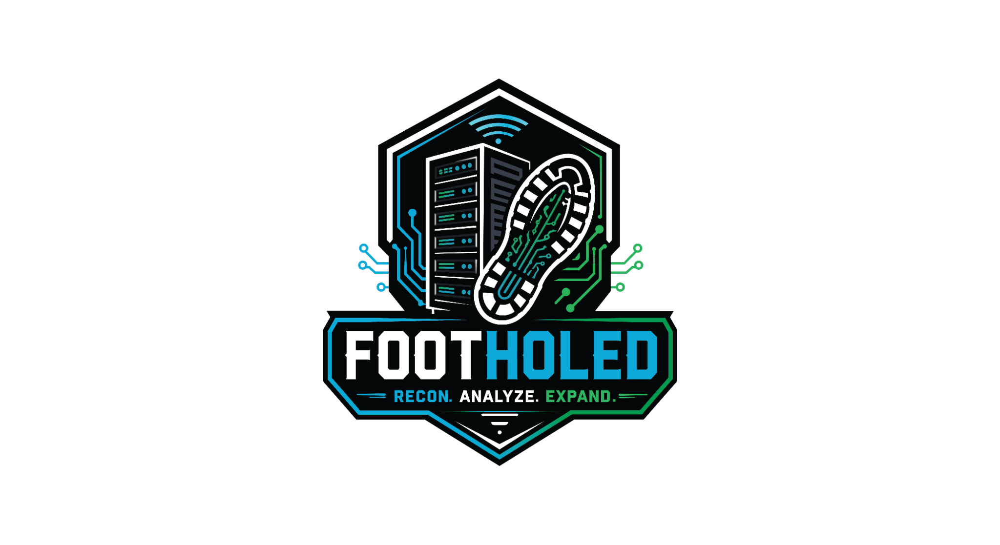

# FootHoled
```
______          _   _   _       _          _
|  ___|        | | | | | |     | |        | |
| |_ ___   ___ | |_| |_| | ___ | | ___  __| |
|  _/ _ \ / _ \| __|  _  |/ _ \| |/ _ \/ _` |
| || (_) | (_) | |_| | | | (_) | |  __/ (_| |
\_| \___/ \___/ \__\_| |_/\___/|_|\___|\__,_|
```




**Recon. Analyze. Expand.**

FootHoled H1 is an experimental, modular ESP32-S3 handheld for authorized wireless-security research, hardware experimentation and offline-first field observations. **This package is intended for the `dev` branch; do not replace `main` without review.**

## Current state
- **Interactive browser prototype:** Open [`prototype/index.html`](prototype/index.html) in a browser. Navigation, settings, demo module discovery, and sample privacy masking work. This is not device firmware.
- **LVGL 9 source:** `firmware/` contains native UI code and a PlatformIO/ESP-IDF foundation. **The Waveshare AXS15231B QSPI display and touch board-support adapter is not yet integrated or tested.** It is not yet a flash-and-use touchscreen release.
- **Hardware functions:** Radio, GNSS, NFC, IR, storage and module probing are currently stubs; demonstration data is explicitly labeled.

## Development entry points
1. Read [`AGENTS.md`](AGENTS.md), [`docs/ARCHITECTURE.md`](docs/ARCHITECTURE.md), and [`hardware/components.yaml`](hardware/components.yaml).
2. Open `prototype/index.html` and explore Recon / Analyze / Expand and Settings.
3. Implement and verify the Waveshare **ESP32-S3-Touch-LCD-3.5B** board adapter using the *3.5B* vendor examples, then connect `firmware/src/ui.cpp` to real LVGL display/touch registration.
4. Add real hardware modules through the service interface, never directly in UI event callbacks.

## Documents
[Vision](docs/PROJECT_VISION.md) · [Architecture](docs/ARCHITECTURE.md) · [Hardware](docs/HARDWARE.md) · [UI](docs/UI_NAVIGATION.md) · [Module development](docs/MODULE_DEVELOPMENT.md) · [Privacy](docs/PRIVACY.md) · [Roadmap](docs/ROADMAP.md) · [Development](docs/DEVELOPMENT.md) · [Project history](docs/PROJECT_HISTORY.md)

## Licensing
The upstream repository has used MIT; retain the existing repository `LICENSE` when merging this package. This archive does **not** relicense existing code. The FootHoled name/logo and DEF CON-exclusive enclosure/PCB artwork are **not** granted under the code license. See `docs/BRANDING.md`.
